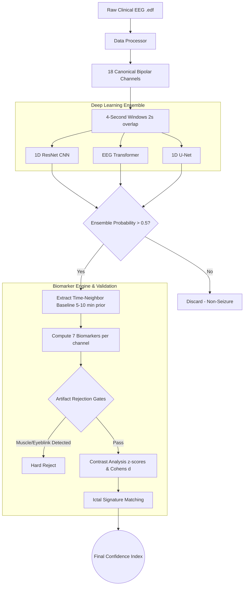

# Robust Clinical EEG Seizure Detection Pipeline (v2)

This repository contains a state-of-the-art, biologically-grounded Deep Learning pipeline for detecting epileptic seizures from continuous scalp EEG data (specifically optimized for the CHB-MIT dataset).

---

## 🚀 How to Run (For New Developers)

You do **not** need to manually install Python, Anaconda, or PyTorch. This pipeline is fully containerized with Docker to guarantee zero dependency conflicts.

### Prerequisites
1. Install [Git](https://git-scm.com/)
2. Install [Docker Desktop](https://www.docker.com/products/docker-desktop/)
3. *(Optional)* NVIDIA GPU drivers and NVIDIA Container Toolkit if you want GPU acceleration.

### Quick Start

**Option A: Running via Docker (Recommended)**
The Docker container automatically installs dependencies and runs `main.py` for you.
1. Clone the repository: `git clone <your-github-repo-url> && cd pipeline`
2. Run the pipeline: `docker-compose up --build`
*(Note: The container will download the required `.edf` files into your `data/` folder automatically).*

**Option B: Running Locally (Without Docker)**
If you prefer to run the scripts directly on your own machine:
1. Install dependencies: `pip install -r requirements.txt`
2. Run the inference pipeline: `python main.py`
3. Run the training script: `python train.py`

### GPU Support (Massive Speedup)
If you have an NVIDIA GPU and the NVIDIA Container Toolkit installed, you can run the pipeline with full CUDA acceleration. Instead of the standard command, use:
```bash
docker-compose -f docker-compose.yml -f docker-compose.gpu.yml up --build
```
The pipeline code natively detects `cuda` and will push the Deep Learning models and continuous EEG tensors directly to the GPU.

---

## 🧠 The Thought Behind This Work
Most AI seizure detection models look great in academic papers (claiming 99% accuracy) but fail catastrophically in real clinical environments. We built this pipeline to directly solve the three biggest flaws in standard EEG AI:
1. **The Data Leakage Trap**: Standard models shuffle overlapping time-windows, accidentally memorizing the test set. Our dataloader strictly splits by continuous *files/events*.
2. **The Class Imbalance Trap**: Seizures represent <1% of clinical data. We utilize `FocalLoss` and Hard Negative Mining so the model is penalized heavily for ignoring the rare positive class.
3. **The False Positive Trap (EMG/Artifacts)**: Deep learning often confuses muscle movement (EMG) or eye blinks (EOG) for seizures. Instead of trusting the AI blindly, we built a **Dual-Branch Architecture**. The AI proposes a seizure, but a deterministic **Biomarker Engine** verifies it against the patient's own historical baseline (Time-Neighbor Analysis) before passing it through Artifact Rejection Gates.

---

## 🏗️ Pipeline Architecture



---

## 📁 Repository Structure
* `data_processor.py`: Downloads EDFs, handles CHB-MIT native bipolar montage extraction, filters (0.5-45Hz, 60Hz Notch), and slices data.
* `model_cnn.py`: 1D PyTorch ResNet for morphological feature extraction.
* `model_transformer.py`: EEG Transformer for capturing long-term attention dependencies.
* `model_unet.py`: 1D U-Net for highly precise temporal boundary detection.
* `biomarkers.py`: Computes the 7 highly-separable biomarkers using Welch's PSD and statistical metrics.
* `ensemble_connector.py`: Evaluates Artifact Rejection Gates (muscle noise vs eyeblinks) and calculates the logical Confidence Index.
* `train.py`: GPU-native training script utilizing Focal Loss and Event-Based leak-free datasets.
* `main.py`: The serial orchestration script that runs the entire end-to-end inference pipeline.
